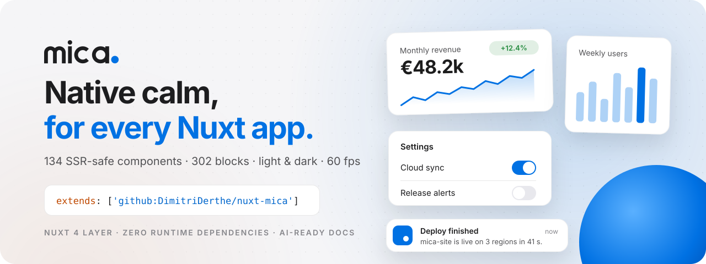

<div align="center">

<a href="https://dimitriderthe.github.io/nuxt-mica/">
  <picture>
    <source media="(prefers-color-scheme: dark)" srcset=".github/assets/banner-dark.svg">
    
  </picture>
</a>

<h3>The native-feeling UI layer for Nuxt 4.</h3>

<p>One line in <code>nuxt.config</code>. No npm package, no plugin, no imports.<br>Then write <code>&lt;MiButton&gt;</code>.</p>

<p>
  <a href="https://github.com/DimitriDerthe/nuxt-mica/releases"></a>
  <a href="https://nuxt.com/docs/getting-started/layers"></a>
  <a href="https://vuejs.org"></a>
  <a href="https://www.typescriptlang.org"></a>
  <a href="LICENSE"></a>
</p>
<p>
  <a href="#whats-inside"></a>
  <a href="docs/blocks.md"></a>
  <a href="#built-for-60-fps"></a>
  <a href="#theming"></a>
  <a href="#ai-ready-docs"></a>
  <a href="https://github.com/DimitriDerthe/nuxt-mica/actions/workflows/pages.yml"></a>
</p>

**[Website](https://dimitriderthe.github.io/nuxt-mica/)** ·
**[Component explorer](https://dimitriderthe.github.io/nuxt-mica/components)** ·
**[Blocks](https://dimitriderthe.github.io/nuxt-mica/blocks)** ·
**[Live demo](https://dimitriderthe.github.io/nuxt-mica/demo/showcase)** ·
**[llms.txt](llms.txt)**

</div>

---

A Nuxt 4 layer shipping 134 SSR-safe UI components, 177 `<Mi…>` tags counting the parts of compound components, from buttons and forms to charts, chat and AI interfaces. Everything is built on a single set of `--mi-*` CSS tokens, so screens built months apart still feel like one product.

## Why Mica

<table>
  <tr>
    <td width="33%" valign="top">
      <h4>⚡ One line to start</h4>
      A native Nuxt layer fetched from GitHub. Components, tokens and composables are auto-registered and SSR-safe from the first render.
    </td>
    <td width="33%" valign="top">
      <h4>🎨 Your brand, every shade</h4>
      Pick two hex colors at runtime; every ramp is derived for light and dark. Theme is read from cookies during SSR: no flash.
    </td>
    <td width="33%" valign="top">
      <h4>🎞️ 60 fps, enforced</h4>
      Motion touches only <code>transform</code> and <code>opacity</code>. A lint script and a frame-time probe keep it that way.
    </td>
  </tr>
  <tr>
    <td width="33%" valign="top">
      <h4>🧱 302 ready-made blocks</h4>
      Dashboards, tables, forms, auth, billing, chat, calendars: copy-paste sections built only with Mica components.
    </td>
    <td width="33%" valign="top">
      <h4>🪶 <code>mi:</code> utility classes</h4>
      A Tailwind-like atomic engine with no dependency and no runtime. Only the classes you use are generated, at build time.
    </td>
    <td width="33%" valign="top">
      <h4>🤖 Docs your AI can read</h4>
      <code>llms.txt</code> covers the whole library in about 3k tokens, with one small API file per component.
    </td>
  </tr>
</table>

## Quick start

**1. Extend the layer** in your project's `nuxt.config.ts`:

```ts
export default defineNuxtConfig({
  // pin a release tag for reproducible builds
  extends: ['github:DimitriDerthe/nuxt-mica#v0.7.0'],
  // or follow main: 'github:DimitriDerthe/nuxt-mica'
  // or a local path: '../nuxt-mica'
})
```

**2. Wrap your app root** in the `mi` class so tokens and typography apply:

```vue
<div class="mi" style="min-height:100dvh;background:var(--mi-page);color:var(--mi-label)">
  <NuxtPage />
</div>
```

**3. Write components.** No imports, no prefix path:

```vue
<template>
  <MiCard>
    <div class="mi:grid mi:gap-4">
      <MiStatTile label="Monthly revenue" value="€48.2k" delta="12.4%" />
      <MiSwitch v-model="sync" label="Cloud sync" />
      <MiButton @click="toast.success('Saved')">Save</MiButton>
    </div>
  </MiCard>
  <MiToaster />
</template>

<script setup lang="ts">
const sync = ref(true)
const toast = useMiToast()
</script>
```

> [!TIP]
> Private fork? Set `GIGET_AUTH` to a GitHub token in the consuming project's environment so Nuxt can fetch the layer.

## What's inside

| Group | | Highlights |
|---|--:|---|
| **[Foundations](docs/foundations.md)** | 15 | MiText, MiIcon, MiSurface, MiLogo, MiKbd, MiThemeSwitcher, MiColorPicker, MiColorRamp |
| **[Buttons](docs/buttons.md)** | 6 | MiButton, MiButtonGroup, MiIconButton, MiCopyButton, MiMenu, MiTextLink |
| **[Controls](docs/controls.md)** | 13 | MiSwitch, MiSlider, MiSegmented, MiCheckbox, MiRadioGroup, MiChip, MiRating, MiToggle |
| **[Inputs](docs/inputs.md)** | 21 | MiInput, MiSelect, MiCombobox, MiCommand, MiDatePicker, MiTimePicker, MiEditor, MiFileUpload, MiForm |
| **[Navigation](docs/navigation.md)** | 14 | MiSidebar, MiNavBar, MiTabBar, MiTabs, MiMenubar, MiNavigationMenu, MiBreadcrumb, MiPagination, MiSteps |
| **[Feedback](docs/feedback.md)** | 21 | MiDialog, MiSheet, MiDrawer, MiToast, MiPopover, MiTooltip, MiHoverCard, MiSkeleton, MiConfetti |
| **[Content](docs/content.md)** | 21 | MiCard, MiList, MiTable, MiDataTable, MiTree, MiTimeline, MiCarousel, MiSortable, MiResizable |
| **[Charts](docs/charts.md)** | 13 | MiLineChart, MiBarChart, MiDonutChart, MiScatterChart, MiHeatmap, MiRings, MiSparkline, MiStatTile |
| **[Chat](docs/chat.md)** | 4 | MiMessage, MiBubble, MiMarker, MiMessageScroller (sticks to the bottom while streaming) |
| **[AI](docs/ai.md)** | 6 | MiOrb, MiShimmerText, MiTrace, MiQuestionnaire, MiCodeBlock, MiAttachment |

Every component, with a live preview, prop controls and its full API: **[component explorer](https://dimitriderthe.github.io/nuxt-mica/components)**. The complete list in one file: [`llms.txt`](llms.txt).

### Blocks

302 application sections in 139 categories across 15 families: analytics and KPIs, tables, forms, authentication, application pages, billing, communication, productivity, search, modals, drawers, navigation and more. Each block is one `.vue` file using only Mica components, previewed at mobile, tablet and desktop widths. Browse them on the **[blocks gallery](https://dimitriderthe.github.io/nuxt-mica/blocks)** or in [`docs/blocks.md`](docs/blocks.md).

## Theming

`useMiTheme()` (auto-imported) returns `mode`, `primary`, `secondary`, `resolved`, `isDark`, `setMode`, `setPrimary`, `setSecondary`, `apply`.

```ts
const { setMode, setPrimary } = useMiTheme()
setMode('dark')        // 'light' | 'dark' | 'system'
setPrimary('#5E5CE6')  // every --mi-p* shade follows, in both appearances
```

Set the defaults in `nuxt.config.ts`:

```ts
export default defineNuxtConfig({
  runtimeConfig: { public: { mi: { primary: '#0071E3', secondary: '#BF4800', mode: 'system' } } }
})
```

<details>
<summary><b>How it works and every token</b></summary>

- Switching mode only flips `data-theme` on `<html>`; a theme change does not recompute component styles.
- Cookies (1 year, `SameSite=Lax`): `mi-mode`, `mi-primary`, `mi-secondary`. They are read during SSR, so there is no theme flash; a blocking head script resolves `system` before first paint.
- Brand ramps: `--mi-p*` (primary) and `--mi-s*` (secondary) are generated from a hex and emitted once in `<head>` for both appearances.
- Other CSS variables: `--mi-page`, `--mi-card`, `--mi-label`, `--mi-label2`, `--mi-label3`, `--mi-sep`, `--mi-fill`..`--mi-fill4`, `--mi-field`, `--mi-mat`, `--mi-scrim`, status colors (`--mi-red`, `--mi-green`, `--mi-orange`, ...), radii (`--mi-radius-s|m|l|xl`), shadows (`--mi-sh1..3`), motion (`--mi-dur-1..4`, `--mi-ease`, `--mi-ease-in-out`, `--mi-spring`), `--mi-font`.
- `<MiThemeSwitcher>` and `<MiColorPicker>` give a ready-made UI for the same API.

</details>

## Utility classes

The layer includes `mi-atomic`, a Tailwind-like atomic CSS engine with no dependency and no runtime. Classes are prefixed with `mi:` so they live next to Tailwind without clashing, and the theme maps to the `--mi-*` tokens:

```vue
<div class="mi:@container mi:grid mi:gap-3 mi:@[560px]:grid-cols-2">
  <article class="mi:p-5 mi:rounded-xl mi:bg-card mi:shadow-1 mi:hover:bg-p/10">…</article>
</div>
```

At build time it scans the `app/` directory of every layer and of your project and writes the CSS of the classes it finds, and only those, to `.nuxt/mi-atomic.css` (hot-reloaded in dev). Production builds use short class names and compose per-element styles into the component stylesheets. Syntax, utilities and variants: [docs/atomic.md](docs/atomic.md).

## Built for 60 fps

- Animations and transitions touch only `transform` and `opacity` (plus `filter`/`clip-path` where compositor-friendly). Never `width`, `height`, `top`/`left`, margins, paddings, `box-shadow`, `background` or `all`.
- Pointer-driven updates (drag, slider, sheet, swipe) are coalesced to one write per animation frame via `miOverlayRaf`.
- Brand colors are emitted once; a theme change does not recompute component styles.
- `node scripts/lint-motion.mjs [dir]` scans every component's `<style>` for transitions and keyframes on layout or paint properties and exits non-zero on any violation.
- `node scripts/fps.mjs /<page> [baseUrl]` loads a playground page at mobile (390), tablet (820) and desktop (1440) widths in light and dark, interacts with it, samples `requestAnimationFrame` deltas and long tasks, and reports PASS/FAIL with console errors and horizontal overflow.

## AI-ready docs

Mica is designed to be written by AI assistants as well as by hand:

- [`llms.txt`](llms.txt) lists every component in one line (about 3k tokens).
- `docs/api/<MiName>.md` gives the exact props, slots and emits of one component (about 200 tokens each).
- [`docs/blocks.md`](docs/blocks.md) indexes every block with its path and summary.
- [`components.json`](components.json) holds the same data for tooling.

All of it is generated from the source (`pnpm docs:gen`) and checked by `pnpm docs:check` and the test suite, so it never drifts. Point your assistant at [`AGENTS.md`](AGENTS.md), or copy its rules into your project's `CLAUDE.md`/`AGENTS.md`. The website serves the same files at `/llms.txt`, `/docs/<group>.md` and `/docs/api/<MiName>.md`.

## Contributing

<details>
<summary><b>Development, tests and builds</b></summary>

```bash
pnpm install                                # development only, consumers install nothing
pnpm dev                                    # playground on .playground
pnpm test                                   # unit tests (tests/*.spec.ts)
node scripts/lint-motion.mjs                # motion rules
node scripts/fps.mjs /buttons http://localhost:3100   # frame-time probe (dev server must run)
pnpm build                                  # production build of the playground
pnpm typecheck                              # vue-tsc over layer and playground
node scripts/gen-banner.mjs                 # regenerate the README banner after a count change
```

Node 24 or later is required. TypeScript is pinned to `~5.9` because `vue-tsc` 3.3 is not compatible with TypeScript 7. The playground lives in `.playground/` with one page per group. Binding rules for contributors: [docs/CONVENTIONS.md](docs/CONVENTIONS.md).

</details>

<details>
<summary><b>Releasing</b></summary>

The version lives in `package.json`; the git tag, the README pin and the version shown on the site all follow it. Never edit them by hand.

Every merge to `main` is released automatically by `.github/workflows/release.yml`: after the docs check and tests pass, it runs `pnpm release auto --push`, which bumps `package.json` and the README pin, commits `chore(release): vX.Y.Z`, tags it, then creates the GitHub release (notes grouped from the commits) and redeploys the site. The bump commit is pushed with `GITHUB_TOKEN`, so it never triggers another release.

The level comes from the [Conventional Commits](https://www.conventionalcommits.org) merged since the last `v*` tag (merge commits ignored), highest one wins:

| Commits since the last tag | Bump |
| --- | --- |
| `type!:` or a `BREAKING CHANGE:` footer | major (minor while the version is `0.x`) |
| `feat` | minor |
| `fix`, `perf`, `refactor`, `style`, `revert`, or a non-conventional message | patch |
| only `docs`, `chore`, `ci`, `test`, `build` | no release |

Docs-only and tooling-only merges do not change what a consumer pinning a tag gets, so they ride along with the next real release. Before 1.0, semver makes no stability promise, so a breaking change bumps the minor (`0.3.x` → `0.4.0`); the first major is a deliberate `pnpm release 1.0.0`. The rules live in `scripts/bump-level.mjs` and are unit-tested.

Locally, the same script:

```bash
pnpm release auto --dry-run # print the level and version the next merge would get
pnpm release patch --push   # or minor, major, x.y.z: force a level, commit, tag vX.Y.Z, push
pnpm release:check          # also part of the test suite
```

</details>

<details>
<summary><b>Website and GitHub Pages</b></summary>

`site/` is the Mica landing page. It is a separate Nuxt app that extends the layer exactly like a user project would, in English (default) and French via `@nuxtjs/i18n`.

```bash
pnpm site:dev        # http://localhost:3010 (French at /fr)
pnpm site:generate   # static output in site/.output/public, ready for an S3 bucket
```

The component explorer lives at `/components`: one page per component with a live preview, prop controls inferred from the generated manifest, a usage snippet and the full API. Each preview is a small file in `site/app/examples/<MiName>.vue`; see `site/app/examples/README.md` for the contract. A new component shows its API page right away and a placeholder until its example is added.

Blocks live at `/blocks`, one SFC per block in `site/app/blocks/<family>/<category>/`, described by the `meta.json` next to it; rules in `site/app/blocks/README.md`, inventory in [docs/blocks.md](docs/blocks.md).

```bash
pnpm pages:build     # site at /nuxt-mica/, playground demos at /nuxt-mica/demo/, output in pages-dist
pnpm pages:preview   # serve pages-dist locally (mount it under /nuxt-mica/ to test the sub-path)
```

`.github/workflows/pages.yml` runs the docs check, the tests and `pages:build`, then deploys `pages-dist` on every push to `main`. In the repository settings, set Pages > Source to "GitHub Actions". The sub-path is the repository name; for a user or organisation site (or a custom domain) run `node scripts/build-pages.mjs ""` to build for the root.

Set `NUXT_PUBLIC_I18N_BASE_URL` to the public origin (hreflang and canonical tags) and `NUXT_PUBLIC_SHOWCASE_URL` to where the playground showcase is served. The component catalog and the `llms.txt` excerpt on the page are read from the generated manifest at build time, so they never drift.

</details>

---

<div align="center">
  <sub>MIT licensed · Made with care for calm interfaces · <a href="https://dimitriderthe.github.io/nuxt-mica/">dimitriderthe.github.io/nuxt-mica</a></sub>
</div>
